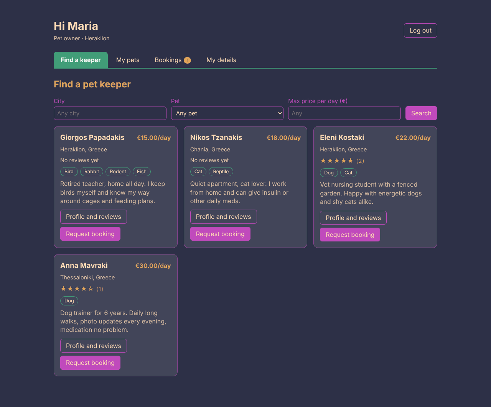
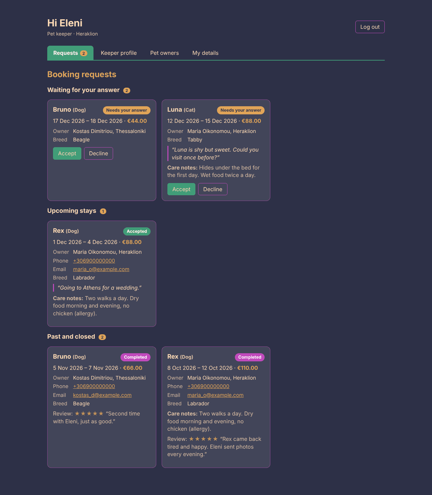

# PawConnect

[](https://github.com/40is40inos/PawConnect/actions/workflows/ci.yml)

A marketplace where pet owners find pet keepers (sitters) and book stays for their pets. Keepers set their price and the animals they look after. Owners search, send booking requests and review keepers after a stay.

It started as a team project for the Internet-Centric Computing course (HY359) at the University of Crete. I later rebuilt the backend security and added the marketplace features: pets, keeper profiles, search, bookings and reviews, all with automated tests.



## Features

**Pet owners**
- Add pets with species, breed, age, weight and care notes for the keeper.
- Search keepers by city, species and maximum daily price, with average ratings.
- Request a booking for a pet and dates. The price (days × daily rate) is shown before sending and fixed at request time.
- Withdraw a request, or cancel an accepted booking before it starts.
- Review the keeper (1–5 stars and a comment) after an accepted stay has ended.

**Pet keepers**
- Set a profile: bio, daily rate and the species they look after. Keepers appear in search only once this is filled in.
- Accept or decline requests, with the pet's care notes in view.

**Everyone**
- Contact details stay private until it makes sense to share them. Guests see none. Logged-in users see a keeper's email and phone. The owner and the keeper see each other's details only after a booking is accepted.
- Admins can list and delete users. Deleting a user removes their pets, bookings and reviews.

| Owner's bookings | Keeper's requests |
|---|---|
|  |  |

## Business rules

These rules are enforced on the server and covered by the tests:

- A booking can only be for one of your own pets, with a keeper who accepts that species.
- Stays start today or later and last at most 30 days.
- A pet can't have two active bookings on overlapping dates.
- A keeper takes one stay at a time, so they can't accept two bookings with overlapping dates. Accepting runs in a database transaction that locks the keeper's row, so two simultaneous accepts can't both succeed.
- Booking status only moves forward: `REQUESTED → ACCEPTED | DECLINED` (keeper) and `REQUESTED | ACCEPTED → CANCELLED` (owner, before the stay starts). Any other change returns `409 Conflict`.
- One review per booking, and only after an accepted stay has ended.
- A pet with upcoming bookings can't be deleted. Deleted pets are soft-deleted, so past bookings still show them.
- Other people's pets and bookings answer `404`, so their ids can't be probed.

## Tech stack

| Part | Technology |
|---|---|
| Frontend | React 18, React Router 6, Axios |
| Backend | Node.js, Express 5, Sequelize ORM |
| Database | MySQL (SQLite in tests) |
| Security | bcrypt, JWT in an httpOnly cookie, Zod validation, Helmet, express-rate-limit |
| Testing and CI | Jest, Supertest, Playwright (manual end-to-end run), GitHub Actions |

## How authentication works

- **Passwords** are hashed with bcrypt (cost 12). The hash is excluded from every query result by default.
- **Sessions** use a signed JWT (HS256, 1 hour) in an `httpOnly`, `SameSite=Lax` cookie, marked `Secure` in production. It holds only the username and role.
- **Authorization** is checked on the server for every request with `requireAuth` and `requireRole`. The current user always comes from the session, never from the URL or the body.
- **Input validation** uses strict Zod schemas, so unknown fields (`type`, `passwordHash`, `ownerUserName`…) are rejected. This blocks mass assignment.
- **Login** returns the same error for an unknown user and a wrong password, and is limited to 10 attempts per IP every 15 minutes.

## API

All endpoints are under `/api`.

| Method | Path | Access | Description |
|---|---|---|---|
| POST | `/auth/register` | Public | Create an owner or keeper account |
| POST | `/auth/login` | Public, rate limited | Log in |
| POST | `/auth/logout` | Public | Log out |
| GET | `/auth/me` | Logged in | Current profile |
| PATCH | `/users/me` | Owner, keeper | Update own details |
| GET | `/users/owners` | Keeper, admin | List pet owners |
| GET | `/keepers?city=&species=&maxRate=` | Public | Search keepers |
| GET | `/keepers/:userName` | Public | Keeper profile and reviews |
| GET, PUT | `/keeper-profile` | Keeper | Read or save own keeper profile |
| GET, POST | `/pets` | Owner | List or add own pets |
| PATCH, DELETE | `/pets/:id` | Owner | Edit or remove own pet |
| GET | `/bookings`, `/bookings/:id` | Owner, keeper | Own bookings |
| POST | `/bookings` | Owner | Request a booking |
| POST | `/bookings/:id/accept`, `/decline` | Keeper | Answer a request |
| POST | `/bookings/:id/cancel` | Owner | Cancel |
| POST | `/bookings/:id/review` | Owner | Review a completed stay |
| GET | `/admin/users` | Admin | List all users |
| DELETE | `/admin/users/:username` | Admin | Delete a user and their data |

## Running locally

Requirements: Node.js 20+ and MySQL 8.

```bash
# 1. Backend
cd backend
cp .env.example .env        # set DB_* and JWT_SECRET
npm install
npm run seed-demo           # optional: demo keepers, owners, pets, bookings, reviews
npm start                   # http://localhost:5000, creates tables on first run

# 2. Frontend, in a second terminal
cd frontend
npm install
npm start                   # http://localhost:3000, proxies /api to the backend
```

The demo accounts all use the password `demo-password`:
- owners: `maria_o`, `kostas_d`
- keepers: `eleni_k`, `giorgos_p`, `anna_m`, `nikos_t`
- admin: `demo_admin`

To create a real admin account instead:

```bash
ADMIN_USERNAME=admin_name ADMIN_PASSWORD='a-long-password' npm run create-admin
```

To try it without MySQL, set `DB_DIALECT=sqlite` and `DB_STORAGE=./dev.sqlite` in `backend/.env`. If the frontend fails with `options.allowedHosts[0] should be a non-empty string`, a known Create React App bug, start it with `DANGEROUSLY_DISABLE_HOST_CHECK=true npm start`.

## Tests

```bash
cd backend
npm test
```

The 68 tests run against an in-memory SQLite database, so no MySQL server is needed. They cover:
- authentication, role checks and forged cookies;
- validation and mass-assignment attempts;
- pet ownership, keeper search filters and ratings;
- the full booking life cycle: pricing, overlaps, every allowed and forbidden status change;
- reviews, soft-deleted pets, and cascade on user deletion.

GitHub Actions runs the tests and a production build of the frontend on every push.

## Project structure

```text
backend/
├── app.js              # Express app (no listen), used by server.js and the tests
├── server.js           # Entry point
├── routes/             # URL → controller, with the access rule for each route
├── controllers/        # HTTP layer: read the request, call a service, send JSON
├── services/           # Business rules and database queries
│   ├── userService.js      accounts and login
│   ├── petService.js       pets
│   ├── keeperService.js    keeper profiles, search, ratings
│   └── bookingService.js   booking life cycle and reviews
├── models/             # Sequelize models and relationships
├── middleware/         # Session, role checks, validation, error handling
├── validation/         # Zod request schemas
├── scripts/            # create-admin, seed-demo
└── tests/              # Jest + Supertest
frontend/src/
├── api/                # Axios client and API calls
├── components/         # Keeper search, booking form, pets, bookings, profiles
├── pages/              # login, register, dashboard, guest, keeper page, admin
└── utils/              # Labels, date and price formatting
```

## Not built yet

- Messaging between owners and keepers inside the app.
- Payments: prices are shown but not charged.
- Keeper availability calendars and multi-pet bookings.
- Database migrations: tables are created with `sequelize.sync()`. If you ran an older version of this project, drop its tables first.
