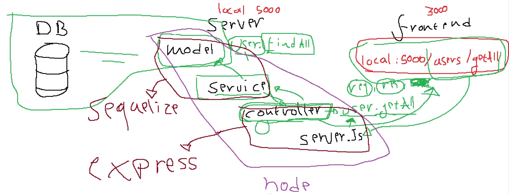

# PawConnect

[](https://github.com/40is40inos/PawConnect/actions/workflows/ci.yml)

A web app where pet owners find pet keepers (sitters) and keepers find owners. It has three roles: pet owner, pet keeper and admin.

It started as a team project for the Internet-Centric Computing course (HY359) at the University of Crete. I later reworked the backend: password hashing, server-side role checks, input validation and an automated test suite.



## Features

- Register as a pet owner or a pet keeper, log in and out, and edit your profile.
- Guests can browse pet keepers. Contact details (email, phone) are shown only to logged-in users. Addresses are never shown in listings.
- Pet keepers can browse pet owners, and pet owners can browse pet keepers.
- Admins can list and delete users. Admin accounts can only be created from the command line.

## Tech stack

| Part | Technology |
|---|---|
| Frontend | React 18, React Router 6, Axios |
| Backend | Node.js, Express 5, Sequelize ORM |
| Database | MySQL (SQLite in tests) |
| Security | bcrypt, JWT in an httpOnly cookie, Zod validation, Helmet, express-rate-limit |
| Testing and CI | Jest, Supertest, GitHub Actions |

## How authentication works

- **Passwords** are hashed with bcrypt (cost 12) before they are stored. The hash is excluded from every query result by default.
- **Sessions** use a signed JWT (HS256, 1 hour) in an `httpOnly`, `SameSite=Lax` cookie, marked `Secure` in production. It holds only the username and role, and browser JavaScript cannot read it.
- **Authorization** is enforced on the server for every request (`requireAuth`, `requireRole`). Users can only edit their own profile: the username comes from the session, never from the URL.
- **Input validation** uses strict Zod schemas, so unknown fields such as `type` or `passwordHash` are rejected. This prevents users from promoting themselves.
- **Login** returns the same error for an unknown user and a wrong password, and takes the same time in both cases. Attempts are limited to 10 per IP every 15 minutes.
- Changing the password requires the current password.

## API

All endpoints are under `/api`.

| Method | Path | Access | Description |
|---|---|---|---|
| POST | `/auth/register` | Public | Create an owner or keeper account and log in |
| POST | `/auth/login` | Public, rate limited | Log in |
| POST | `/auth/logout` | Public | Clear the session cookie |
| GET | `/auth/me` | Logged in | Current profile |
| GET | `/users/keepers` | Public | List keepers (contact details only when logged in) |
| GET | `/users/owners` | Keeper, admin | List owners |
| PATCH | `/users/me` | Owner, keeper | Update own profile |
| GET | `/admin/users` | Admin | List all users |
| DELETE | `/admin/users/:username` | Admin | Delete a user |

## Running locally

Requirements: Node.js 20+ and MySQL 8.

```bash
# 1. Backend
cd backend
cp .env.example .env        # set DB_* and JWT_SECRET
npm install
npm start                   # http://localhost:5000, creates tables on first run

# 2. Create an admin account (optional)
ADMIN_USERNAME=admin_name ADMIN_PASSWORD='a-long-password' npm run create-admin

# 3. Frontend, in a second terminal
cd frontend
npm install
npm start                   # http://localhost:3000, proxies /api to the backend
```

## Tests

```bash
cd backend
npm test
```

The 36 tests run against an in-memory SQLite database, so no MySQL server is needed. They cover:
- password hashing, and that no password or hash ever leaves the API;
- role checks on every protected route, including forged session cookies;
- validation and mass-assignment attempts;
- password changes, rate limiting and error responses.

GitHub Actions runs the tests and a production build of the frontend on every push.

## Project structure

```text
backend/
├── app.js              # Express app (no listen), used by server.js and the tests
├── server.js           # Entry point
├── controllers/        # HTTP layer: read the request, call a service, send JSON
├── services/           # Business logic and database queries
├── models/             # Sequelize models
├── middleware/         # Session, role checks, validation, error handling
├── routes/             # URL to controller mapping and access rules
├── validation/         # Zod request schemas
├── scripts/            # create-admin CLI
└── tests/              # Jest + Supertest
frontend/src/
├── api/                # Axios client and API calls
├── components/
└── pages/              # login, register, main page, guest, admin
```

## Not built yet

- Pet profiles, booking requests between owners and keepers, and reviews.
- Search and filtering by city.
- Database migrations: tables are created with `sequelize.sync()`. If you ran an older version of this project, drop its tables first, because the schema changed.
